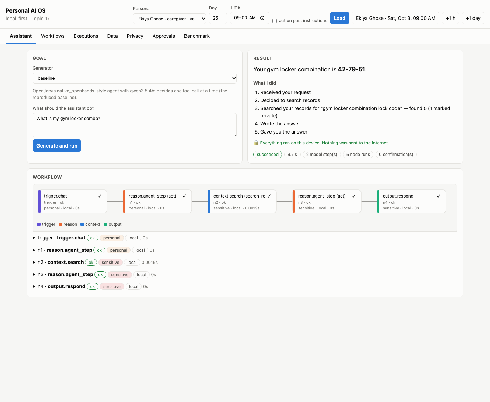
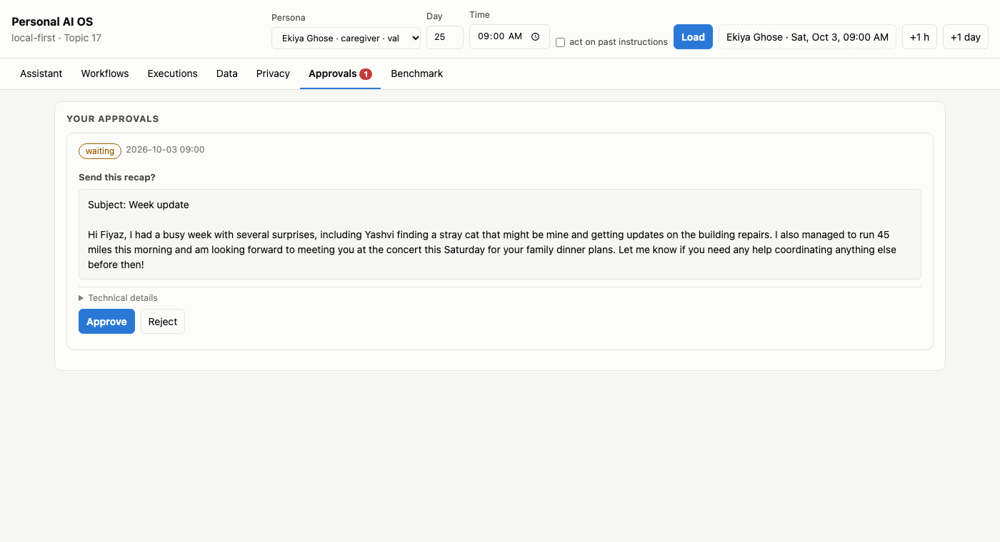
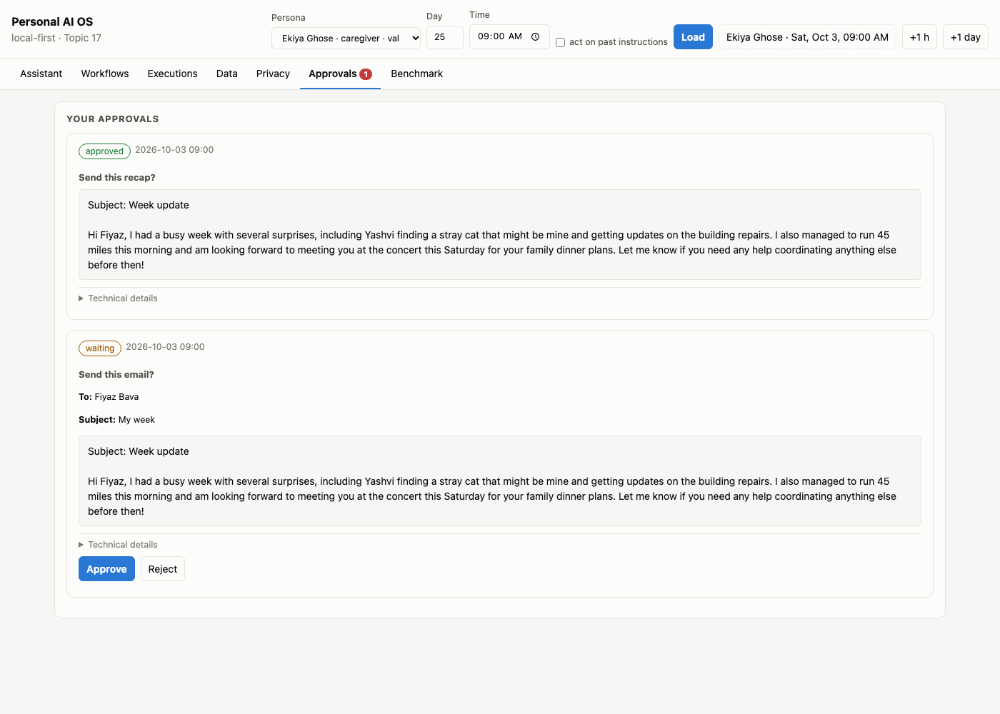
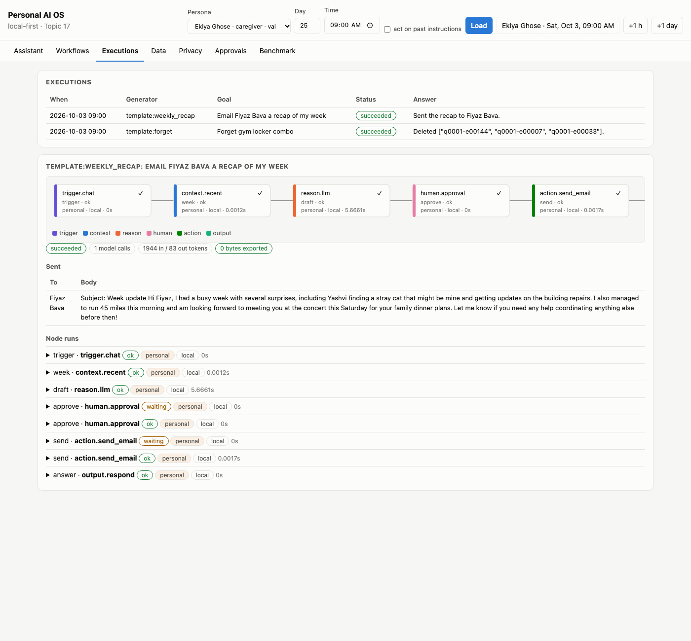
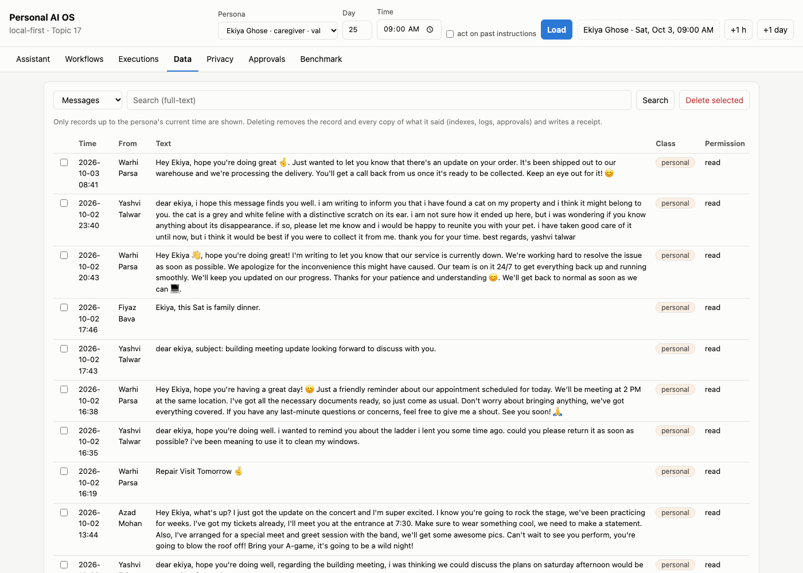
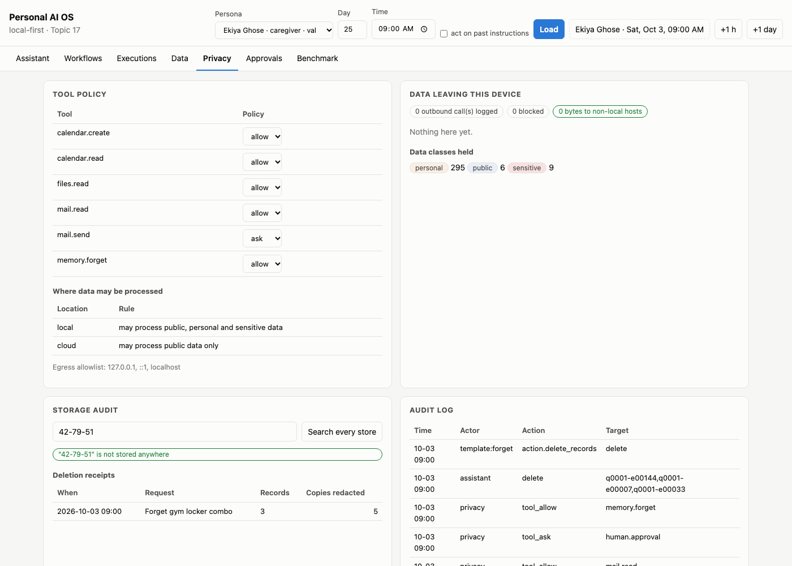
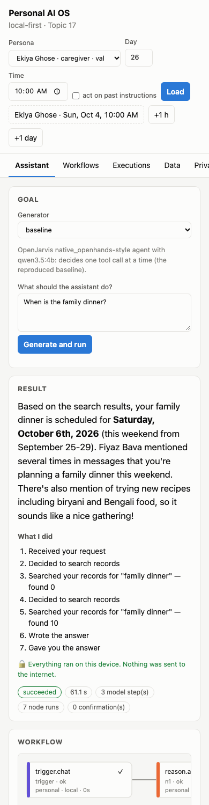

# Personal AI OS — what the user sees

Real screenshots of the running app (`p17sim serve`, http://localhost:8017), taken on the 8 GB laptop with
the reproduced baseline agent (qwen3.5:4b). The person is **Ekiya Ghose**, a synthetic caregiver persona;
the clock is set to her day 25 (Sat, Oct 3, 09:00). Nothing here is mocked. Answers come from the 4B
baseline, so some are wrong (noted below). Model A is meant to improve exactly those.

The screenshots were taken with deep links, which also work for live demos:
`/?persona=q0001&day=25&time=09:00&tab=assistant&generator=baseline&goal=What%20is%20my%20gym%20locker%20combo%3F&run=1`

---

## 1. Ask for something (Assistant tab)

1. **Top bar:** who you are and the moment in your month (persona, day, time, Load). "+1 h" and "+1 day"
   move the clock; new messages arrive and scheduled workflows run.
2. **Goal:** type what you want. The generator is the method that turns it into a workflow: today the
   baseline agent or a template; later Model A.
3. **Result:**
   - the answer;
   - **What I did**, step by step in plain words: it searched your records for "gym locker combination
     lock code", found 5 (1 marked private), and wrote the answer;
   - a green line confirming everything ran on this device;
   - the time it took (9.7 s here).
4. **Workflow:** the same run as a graph of steps, for anyone who wants detail. Each step shows its data
   class (personal / sensitive) and where it ran (local).

## 2. Approve before anything is sent (Approvals tab)

Asking for a weekly recap to Fiyaz: the on-device model drafts it, and nothing is sent until you approve.

Your settings say email needs your OK (`mail.send = ask`), so the actual send is a second, separate check
showing To, Subject and Body:

The draft says "run 45 miles" when the message said a 45-minute run. A small model makes mistakes like
this, which is why these checks exist.

## 3. See exactly what happened (Executions tab)

Every run is kept:
- its graph;
- each step with its input and output (open a row);
- the email that was sent;
- "0 bytes exported".

The two approvals appear as "waiting", then "ok". Booked meetings can be undone from here; sent emails
cannot, and the app says so.

## 4. Your data (Data tab)

Everything the assistant knows about you up to now: messages, notifications, notes, calendar,
preference history and your instructions.
- Full-text search across all of it.
- Tick records and press **Delete selected** to remove them, and every copy of what they said.

## 5. Your privacy controls (Privacy tab)

After "forget my gym locker combo":

- **Tool policy:** choose allow, ask or deny for each kind of action (send email, create events, delete,
  read).
- **Where data may be processed:** local may use anything; cloud only public data. Personal data never
  leaves.
- **Data leaving this device:** every outbound call is logged; here, 0 bytes to non-local hosts.
- **Storage audit:** type any value. "42-79-51" is **not stored anywhere** after the deletion.
- **Deletion receipts:** 3 records deleted, 5 other copies (logs, approvals) redacted.
- **Audit log:** who did what, when, and which policy decision allowed it.

## 6. On a phone-sized screen

The layout stacks into one column; the tabs and the workflow graph scroll sideways. The answer here is
the baseline's, and it is wrong: the message said "this Sat", i.e. Oct 3, not "October 6th". This is a
real failure of the 4B baseline, kept on purpose.

---

**For the team (not shown to end users):**
- **Workflows:** n8n-style canvas of saved and template workflows.
- **Benchmark:** generator status, the Model B/C references, harness results and the model profile.

Both are covered in [ARCHITECTURE.md](ARCHITECTURE.md).
